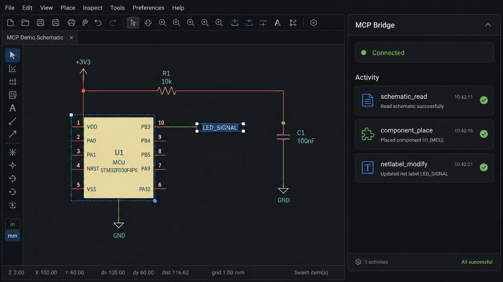

# MCP Bridge 社区版

让支持 MCP 的 AI 客户端连接嘉立创 EDA，读取和编辑原理图、PCB 与封装，搜索器件、检查设计并导出数据。

基于 [sengbin/JLCEDA-MCP](https://github.com/sengbin/JLCEDA-MCP) 维护，非嘉立创官方插件。

## 功能演示


历史版本录屏；当前版本的安装与连接方式见下方说明。

<details>
<summary>查看功能流程示意图</summary>



此图为功能流程示意，实际界面以当前 EDA 版本为准。

</details>

## 安装与连接

需要嘉立创 EDA 专业版 3.x/4.x、Node.js 20+ 和支持 MCP 的 AI 客户端；具体功能受 EDA 版本限制。

1. 从[发布页](https://github.com/hs150521/JLCEDA-MCP-Community/releases/latest)下载同版本的扩展 `.eext` 和 Server `.tgz`。
2. 在 EDA 的「高级 → 扩展管理器 → 导入」安装扩展，启用「外部交互」权限，重启 EDA 并打开原理图、PCB 或独立封装文档。
3. 在下载目录安装 Server（以 2.4.0 为例）：

   ```powershell
   npm install --global .\jlceda-mcp-server-2.4.0.tgz
   ```

4. 在 AI 客户端添加本地 STDIO MCP 服务，启动命令填 `jlceda-mcp`。
5. 在「MCP Bridge 社区版 → 连接设置」确认已连接；默认地址为 `ws://127.0.0.1:8765/bridge/ws`。

## 使用说明

连接后直接向 AI 描述任务。修改前保存工程并确认目标项目和页面；交互放置时按 Esc 或右键结束。无法连接时检查 Server、端口、Token 和「外部交互」权限。写入超时后按诊断核对结果，勿盲目重试。

[安装与排查指南](https://github.com/hs150521/JLCEDA-MCP-Community/blob/main/docs/native-mcp-setup.md) · [CHANGELOG](https://github.com/hs150521/JLCEDA-MCP-Community/blob/main/mcp-bridge/CHANGELOG.md) · [问题反馈](https://github.com/hs150521/JLCEDA-MCP-Community/issues)

[Apache License 2.0](https://github.com/hs150521/JLCEDA-MCP-Community/blob/main/mcp-bridge/LICENSE) · [隐私说明](https://github.com/hs150521/JLCEDA-MCP-Community/blob/main/mcp-bridge/PRIVACY.md)
